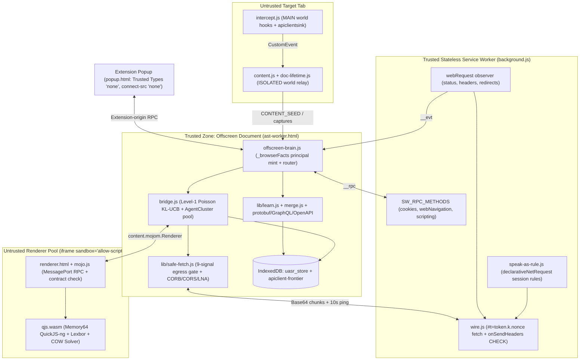
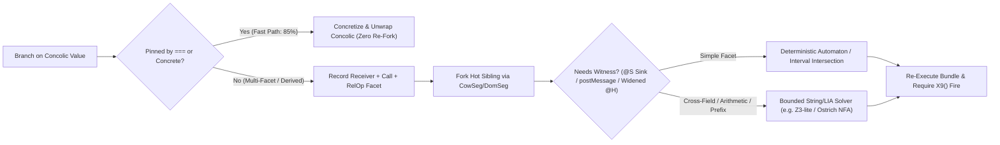

# APIClient Deep Architectural Review & Alternative Design Analysis

## 1. Executive Thesis & Overall Opinion

**APIClient** ("API Security Researcher") is far more than a Chrome extension: across ~1.7M tracked lines (~535k LOC in [`engine/host/browser/`](file:///d:/APIClient/engine/host/browser), ~78k LOC in [`engine/host/solver/`](file:///d:/APIClient/engine/host/solver), ~203k LOC in forked [`engine/qjs/`](file:///d:/APIClient/engine/qjs), ~647k LOC in vendored/modified [`engine/lexbor/`](file:///d:/APIClient/engine/lexbor), ~72k LOC in [`engine/`](file:///d:/APIClient/engine) build/gate tooling, and ~55k LOC in [`extension/`](file:///d:/APIClient/extension)), it implements a **custom, cooperative, slice-preemptible, Copy-on-Write (COW) concolic web browser compiled to 64-bit WebAssembly**.

> [!IMPORTANT]
> **Core Opinion:** APIClient's central thesis—that static AST scanners fail on modern minified SPAs, and that *executing the unmodified bundle under forced multi-path exploration while requiring every XSS proof-of-concept to fire in a real parse/execution context* is the right epistemic bar—is **spot-on and genuinely ahead of the state of the art**. At the same time, the project suffers from **severe architectural over-internalization**: by insisting on building an entire CSS/layout/paint browser engine from scratch in C, hand-converting ~1,200+ C/IDL entry points into explicit step machines, banning loop/depth bounds (`§NO BOUNDS`), and rejecting even lightweight constraint solving in favor of pure re-execution, the codebase pays massive complexity, memory, and latency taxes that now bottleneck its core mission rather than advancing it.

### Current System Topology

---

## 2. Subsystem-by-Subsystem Deep Review

### 2.1 Forked QuickJS-ng VM & Step-Machine Runtime

**Files:** [`quickjs.c`](file:///d:/APIClient/engine/qjs/quickjs.c), [`quickjs.h`](file:///d:/APIClient/engine/qjs/quickjs.h), [`quickjs-step.h`](file:///d:/APIClient/engine/qjs/quickjs-step.h), [`libregexp.c`](file:///d:/APIClient/engine/qjs/libregexp.c), [`idl_args.c`](file:///d:/APIClient/engine/host/browser/core/idl_args.c)

#### What Is Exceptional
1. **Complete Elimination of C-Stack Recursion:** [`JS_CallInternal`](file:///d:/APIClient/engine/qjs/quickjs.c#L36813-L36820) enforces `rt->current_stack_frame == NULL` via `DCHECKF`, backed by static binary disassembly in [`recgate.mjs`](file:///d:/APIClient/engine/recgate.mjs). Every JS call, getter/setter, constructor, Proxy trap, and ~250+ built-in array/promise/iterator/JSON operations (`STEPDEF_*` at [`quickjs.c`](file:///d:/APIClient/engine/qjs/quickjs.c#L2609-L2754)) push heap-allocated `TrampFrame` records ([`quickjs.c`](file:///d:/APIClient/engine/qjs/quickjs.c#L29330)). Even self-hosted JS builtins from upstream QuickJS (`Array.fromAsync`, `Iterator.zip`) were deleted and rewritten as C step machines so closures cannot hide opaque state from [`clone_deep_flow`](file:///d:/APIClient/engine/qjs/quickjs.c#L55456).
2. **Preemptible RegExp, Parser, and Web IDL Coercions:** Converting [`libregexp.h`](file:///d:/APIClient/engine/qjs/libregexp.h#L122-L165) (`lre_compile_step`, `lre_exec_step`) and recursive Web IDL dictionary/sequence/union conversions (`IdlConvFrame` in [`idl_args.c`](file:///d:/APIClient/engine/host/browser/core/idl_args.c#L1800-L2463)) into heap state machines ensures neither ReDoS regexes nor deeply nested `Proxy` getters stall the cooperative slice quantum (`FLOW_YIELD_READ` in [`quickjs.c`](file:///d:/APIClient/engine/qjs/quickjs.c#L36517-L36525)) or block mid-call branch forking ([`branch_arm_fork`](file:///d:/APIClient/engine/qjs/quickjs.c#L49342)).
3. **Web IDL Concolic Boundary Discipline:** Across [`engine/host/browser/`](file:///d:/APIClient/engine/host/browser), there are **zero** synchronous `JS_Call` or `JS_CallConstructor` invocations—852 bindings route through shared `js_idl_cfunc_step` descriptors in [`idl_args.c`](file:///d:/APIClient/engine/host/browser/core/idl_args.c#L4450-L4650) and 137 custom `JS_RegisterStepDef` machines, audited statically by [`argaudit.mjs`](file:///d:/APIClient/engine/argaudit.mjs) so C bodies do not accidentally strip concolic wrappers via `JS_ToCString`.

#### Architectural Friction & Costs
- **Massive Manual Continuation Tax:** Every new DOM/Web API where user script can run (e.g., Trusted Types default policy callbacks inside `setAttribute`, `[CEReactions]` custom-element constructors, stream controllers) must be manually decomposed into numbered spec stages (`JSStepHdr` + `JSStepVisit` GC/clone hooks), documented across 5,410 lines of [`SPEC_STEPS.md`](file:///d:/APIClient/engine/host/SPEC_STEPS.md). Where an internal C helper holds transient detached state (such as `fragment_parser.c` feeding Lexbor 1 byte per step), the engine resorts to `.unforkable` guards that temporarily suppress concolic branching.
- **Unjustified `wasm64` (`-m64`) Pointer Tax:** [`build.mjs`](file:///d:/APIClient/engine/build.mjs#L6660-L6670) compiles the shipped module exclusively with `-m64` (Memory64, 16 GiB ceiling). In a pointer-dense C codebase (`JSObject`, `TrampFrame`, `CowEntry`, `DomUndo`, `FlowIxNode`, Lexbor `lxb_dom_node_t`), 64-bit pointers inflate working-set RAM and CPU cache pressure by ~35–60%, add V8 Memory64 bounds-check and `BigInt` marshalling overhead at [`abiPointerSignatures`](file:///d:/APIClient/engine/build.mjs#L1251-L1272), and sit inside Emscripten linear memories that **never shrink** once grown ([`c_alloc.h`](file:///d:/APIClient/engine/host/solver/c_alloc.h#L22)). Because each origin cluster already gets its own isolated renderer iframe, needing >4 GiB in a *single* origin cluster is a symptom of memory leaks and unbounded path explosion, not legitimate workload size.

---

### 2.2 Copy-on-Write Isolation, Memory Leaks & Cold-Tier Divergence

**Files:** [`REWRITE.md`](file:///d:/APIClient/engine/REWRITE.md), [`cow.c`](file:///d:/APIClient/engine/host/solver/cow.c), [`dom_cow.c`](file:///d:/APIClient/engine/host/solver/dom_cow.c), [`cold.h`](file:///d:/APIClient/engine/host/solver/cold.h), [`cold.c`](file:///d:/APIClient/engine/host/solver/cold.c), [`navigable.c`](file:///d:/APIClient/engine/host/browser/core/frame/navigable.c), [`window_proxy.c`](file:///d:/APIClient/engine/host/browser/core/frame/window_proxy.c)

#### Evolution Beyond `REWRITE.md`
[`REWRITE.md`](file:///d:/APIClient/engine/REWRITE.md#L25-L54) (June 2026) proposed four fresh cores: (1) heap trampolining, (2) a Binaryen store-barrier pass feeding one 4-tag raw byte undo-log, (3) branch-fork + Z3 pruning + serialized COW-segment eviction, and (4) one unified WFQ across both cross-page and intra-page levels. Comparing [`REWRITE.md`](file:///d:/APIClient/engine/REWRITE.md) against the actual code reveals major architectural pivots:
- **Core 1** was vastly exceeded (~250+ builtins + IDL + RegExp + parser).
- **Core 2 (Binaryen + 4-tag raw log)** was **abandoned**: Binaryen store barriers and Z3 were removed ([`build.mjs`](file:///d:/APIClient/engine/build.mjs#L1-L5)), replaced by four semantic persistent-versioned segment trees—`CowSeg` ([`cow.c`](file:///d:/APIClient/engine/host/solver/cow.c#L311)), `DomSeg` ([`dom_cow.c`](file:///d:/APIClient/engine/host/solver/dom_cow.c#L121)), `ConsSeg` ([`concolic.c`](file:///d:/APIClient/engine/host/solver/concolic.c#L1002)), and `DecSeg` ([`decide.c`](file:///d:/APIClient/engine/host/solver/decide.c#L42))—plus a clever JS private-symbol slot strategy in [`idb_object_store.c`](file:///d:/APIClient/engine/host/browser/core/indexeddb/idb_object_store.c#L14-L17) that rides QuickJS property COW for free.
- **Core 3 (Cold-tier COW serialization)** **diverged fundamentally**: while hot RAM branches fork in $O(1)$ via immutable segment sharing and `JSObject.flow_gen > d->fork_gen` write-skipping ([`cow.c`](file:///d:/APIClient/engine/host/solver/cow.c#L1692)) with Lowest-Common-Ancestor (LCA) delta switching ([`cow_install_chain`](file:///d:/APIClient/engine/host/solver/cow.c#L2044)), **cold-tier eviction in [`cold.h`](file:///d:/APIClient/engine/host/solver/cold.h#L455-L462) does NOT serialize COW or stack segments** because C/JS pointers have no cross-session identity. Instead, `cold_park_tail` serializes `DecSeg` FNV-1a decision vectors and **re-executes from script 0** on [`cold_resume`](file:///d:/APIClient/engine/host/solver/cold.h#L885).

> [!WARNING]
> **Critical Memory & Cold-Tier Bottlenecks Verified in Source:**
> 1. **Active ~500-Allocation-Per-Flow Leak ([`navigable.c`](file:///d:/APIClient/engine/host/browser/core/frame/navigable.c#L76-L82)):** The codebase's own measurement notes that on the default smoke fixture (with zero child realms), C heap grows from **4.6 MB to 3.39 GB across 14,003 flows**, including **1.27 GB across 7.4 million unaccounted blocks** inside QuickJS's allocator (~500 leaked allocations per created flow).
> 2. **Append-Only String & Blob Retention:** Because POD struct snapshots (`COW_STATE_HOST_REC`) restore raw `char *` pointers when switching back to sibling worlds, mutators cannot `free()` replaced strings and instead push every string onto immortal append-only lists (`proxy_strdup` in [`window_proxy.c`](file:///d:/APIClient/engine/host/browser/core/frame/window_proxy.c#L410-L428)). Meanwhile, mutating 1 byte of a baseline `ArrayBuffer` (`COW_STATE_BUFFER`) copies the entire buffer twice (`a_base` and `a_cur` in [`cow.c`](file:///d:/APIClient/engine/host/solver/cow.c#L1702-L1812)), and adding one exclusion to `ConsSeg` deep-clones the entire inherited `Cons` row ([`concolic.c`](file:///d:/APIClient/engine/host/solver/concolic.c#L1085-L1160)).
> 3. **Cold-Tier Replay Amplification & Fitness Loss:** Evicting deep flows to IndexedDB discards all retired parse/execution work, forcing $O(\text{depth})$ replay from script 0 plus $O(\text{depth}^2)$ `dec_at` chain walks, while dropping `@S` candidate distance rungs (`cand_surv`, `cand_rung`, [`engine.h`](file:///d:/APIClient/engine/host/solver/engine.h#L1203-L1205)) so resumed exploit candidates lose their priority advantage.
> 4. **Unpoliced DOM COW Chokepoints & Raw `realloc` Calls:** Static enforcement for DOM mutation barriers was deleted (`check_dom_chokepoint.mjs` noted absent in [`dom_cow.h`](file:///d:/APIClient/engine/host/solver/dom_cow.h#L61)), and several solver sites still call raw `realloc` instead of `reclaim_realloc` ([`reclaim.h`](file:///d:/APIClient/engine/host/solver/reclaim.h#L98-L102)), risking hard `CHECK` aborts before flow eviction can run.

---

### 2.3 Concolic Engine, Two-Level Scheduler & `@S` Exploit Synthesis

**Files:** [`concolic.h`](file:///d:/APIClient/engine/host/solver/concolic.h), [`concolic.c`](file:///d:/APIClient/engine/host/solver/concolic.c), [`decide.c`](file:///d:/APIClient/engine/host/solver/decide.c), [`flow.h`](file:///d:/APIClient/engine/host/solver/flow.h), [`flow.c`](file:///d:/APIClient/engine/host/solver/flow.c), [`solve.c`](file:///d:/APIClient/engine/host/solver/solve.c), [`solve_html.c`](file:///d:/APIClient/engine/host/solver/solve_html.c), [`solve_js.c`](file:///d:/APIClient/engine/host/solver/solve_js.c), [`message_compose.c`](file:///d:/APIClient/engine/host/solver/message_compose.c)

#### What Is Best-in-Class
1. **Grammar-Derived, Fire-Verified `@S` Synthesis ([`solve_html.c`](file:///d:/APIClient/engine/host/solver/solve_html.c), [`solve_js.c`](file:///d:/APIClient/engine/host/solver/solve_js.c)):** Instead of spraying static XSS polyglots, `@S` injects an inert alphanumeric probe (`apiclientprobe`), observes byte-level filter survival (`SolveDelivered[256]`), determines exact sink grammar state via **differential Lexbor HTML §13.2.5 re-parsing** ([`quote_ends_value`](file:///d:/APIClient/engine/host/solver/solve_html.c#L292-L310)) and an **ES §12 lexical + escape-debt scanner** (`esc_owed` in [`solve_js.c`](file:///d:/APIClient/engine/host/solver/solve_js.c#L162)), enforces cross-sink syntax compatibility (`SolveJoint`), and requires realm-intrinsic `X9()` to actually execute. This is genuinely brilliant security engineering: false-positive XSS findings from unexecutable string reflections are eliminated by construction.
2. **Clean Concolic Carrier & Sound `===` vs `==` Pinning:** Keeping `Concolic` as a host `JSClass` ([`concolic.c`](file:///d:/APIClient/engine/host/solver/concolic.c#L62-L262)) preserves QuickJS's NaN-boxing untouched, tracks four-axis provenance (`src`, `root`, `root_whose`, SHA-256-bounded length-prefixed `ident` in [`concolic_ident_compose`](file:///d:/APIClient/engine/host/solver/concolic.c#L380-L430)), and pins concrete witnesses *only* on strict `===` (`concolic_pin_store`), refusing false pins on coercive `==`.
3. **Zero-Allocation Intrusive Frontier Structures:** Embedding Leftist Max-Heaps (`FlowIxNode`) and Splitmix64 Class Treaps (`FlowIxTreap`) inside `Flow` ([`flow.c`](file:///d:/APIClient/engine/host/solver/flow.c#L4255-L4460)) avoids allocator re-entrancy during scheduling.

#### Fundamental Solver & Scheduler Weaknesses
1. **Intra-Document Level-2 WFQ Collapses to `families == 1` on Real Pages:**
   In [`flow_order_key`](file:///d:/APIClient/engine/host/solver/flow.c#L4195-L4203), a flow's priority weight is:
   $$w(f) = \underbrace{(\text{reward} - \text{coord\_notch} \cdot Q)}_{\text{flow\_family\_coord}(f)} + \underbrace{\frac{1}{1 + \frac{\max\left(\frac{\text{site\_served}}{1 + D},\; (\text{assumed} + \text{against\_env}) \cdot W\right)}{\text{pull\_work}} + \text{orphan\_seen}}}_{\text{flow\_optimism}(f)}$$
   Because `reward` and `coord_notch` live on the shared `FlowAcct` root (`flow_fork_inherit` joins the parent's account), **on a real SPA where nearly every flow forks from initial boot, `families == 1`**—explicitly acknowledged in [`flow.h`](file:///d:/APIClient/engine/host/solver/flow.h#L1183-L1192)! Consequently, `flow_family_coord(f)` is an identical constant across every exploration flow and **orders nothing**. Scheduling degenerates to `1 / (1 + site_served / pull_work)` plus `own_silence` turn rotation—and whenever *any* flow emits a novel endpoint, `acct->emit_gen++` resets `own_silence` to zero for *every unproductive sibling in the entire family at once*.
2. **Unbounded Loop Explosion Under `§NO BOUNDS`:**
   Forbidding loop caps and state merging means any loop over unknown-length or unpinned concolic input (`arrivals / picks_lifetime > 1`, [`flow.h`](file:///d:/APIClient/engine/host/solver/flow.h#L1140-L1145)) mints a sibling per iteration faster than dispatches retire them (e.g., 1,699 live flows from one `load`-handler loop on `solvergate stream`, stranding orphan drives). WFQ only reorders an exploding queue; it cannot make a super-linear branching process converge.
3. **Severe Expressiveness Gaps from Refusing Constraint Solving ("Run, Don't Match"):**
   - **Operator-Between-Call-and-Branch Blindness ([`concolic.h`](file:///d:/APIClient/engine/host/solver/concolic.h#L1608-L1636)):** While `if (s.startsWith("a"))` files a predicate on `s`, **`s.indexOf(t) === 0`, `s.charAt(0) === c`, and `s.length > 3`** file their domain facts under the *intermediate derivation's* key, which no emitted parameter or `message_compose` lookup ever reads. As [`concolic.h`](file:///d:/APIClient/engine/host/solver/concolic.h#L1631-L1634) admits, *"the uncovered half is not an edge of this class — it is most of it."*
   - **Fragile Heuristic Synthesis in [`message_compose.c`](file:///d:/APIClient/engine/host/solver/message_compose.c#L119-L167):** [`pred_string`](file:///d:/APIClient/engine/host/solver/message_compose.c#L119-L141) naively concatenates all held `startsWith`, `includes`, and `endsWith` arguments in array order—if a handler checks `d.startsWith("a")` and later `d.startsWith("ab")`, `pred_string` builds `"aab"`, which *fails* `startsWith("ab")` and aborts composition! Similarly, [`bound_number`](file:///d:/APIClient/engine/host/solver/message_compose.c#L145-L167) tries at most 5 hardcoded numbers (`0`, `1`, `lo`, `hi`, `(lo+hi)/2`).
   - **Post-Pin Re-Forking & Unspellable Object Identities:** Pre-materialized locals (`var r = q("role"); if (r === "admin") { if (r.length > 3) ... }`) retain their `Concolic` wrapper and still fork into dead contradicted arms (`g_fork_over_pinned`), while 26.9%–37.2% of forks on pooled real pages involve unregistered page-created objects with `ident == NULL`, losing feasible-refinement pruning.

---

### 2.4 The Browser Core & Visual Rendering Stack

**Files:** [`main.c`](file:///d:/APIClient/engine/host/main.c), [`qjs_abi.h`](file:///d:/APIClient/engine/host/qjs_abi.h), [`realm.c`](file:///d:/APIClient/engine/host/browser/core/realm.c), [`agent_state.c`](file:///d:/APIClient/engine/host/browser/core/agent_state.c), [`element_view.c`](file:///d:/APIClient/engine/host/browser/core/dom/element_view.c), [`block_flow.c`](file:///d:/APIClient/engine/host/browser/core/layout/block_flow.c), [`rendering.c`](file:///d:/APIClient/engine/host/browser/core/rendering/rendering.c), [`fontsubset.mjs`](file:///d:/APIClient/engine/fontsubset.mjs)

#### Where the Visual Engine Genuinely Earns Its Keep
At first glance, finding **205,958 lines** (38.5% of `browser/`) dedicated to `fonts/` (108k LOC), `css/` (54k LOC), `layout/` (33.5k LOC), `paint/` (5.7k LOC), `rendering/` (2.5k LOC), and `graphics/` (1.2k LOC) inside an API/XSS analyzer looks misaligned. Closer inspection shows two real wins:
1. **Viewport-Domain Concolic Provenance (`CssPx` in [`element_view_length_long`](file:///d:/APIClient/engine/host/browser/core/dom/element_view.c#L214-L221)):** Fixed author dimensions (`width: 300px`) return plain concrete numbers (avoiding spurious forks), whereas viewport-dependent dimensions (`document.body.clientWidth < 768`) return concolic unknowns linked to the same `MqEnv` as `window.matchMedia` and `window.innerWidth`, cleanly unlocking mobile-only SPA routes and endpoints!
2. **Ephemeral Layout Memoization & `IntersectionObserver`:** `LayoutJob` builds zero persistent box trees (discarding `LjSlot` memos on flow switch/pressure), while `IntersectionObserver` unlocks lazy-fetched component chunks.

#### Where Scope Creep Hurts Stability, Speed, and Binary Size
1. **Zero Consumers for `paint/`, `graphics/`, and Font Outlines:** [`qjs_abi.h`](file:///d:/APIClient/engine/host/qjs_abi.h#L149-L266) explicitly documents that **all 14 `qjs_paint*` WASM exports have zero callers in `extension/`**. Yet `fonts/*_data.c` embeds **104,678 lines (~1.67 MB of `.rodata`)** of `glyf`/`loca` TrueType glyph outlines ([`fontsubset.mjs`](file:///d:/APIClient/engine/fontsubset.mjs#L158)) needed *only* for software rasterization (layout measurement needs only `cmap`/`hmtx`/`head`/`hhea`/`maxp`), and HTML §8.1.7.3 step 22 (`UR_PAINT` in [`rendering.c`](file:///d:/APIClient/engine/host/browser/core/rendering/rendering.c#L1288-L1336)) still walks the shadow-including DOM to build `DisplayList`s nobody reads.
2. **50.4% of All Browser `DFAIL`s Sit in CSS/Layout/Paint (335 of 665):** Commonplace real-world CSS—such as `list-style-position: inside` ([`block_flow.c`](file:///d:/APIClient/engine/host/browser/core/layout/block_flow.c#L738-L747)) or `clear` / `margin: auto` following a float ([`block_flow.c`](file:///d:/APIClient/engine/host/browser/core/layout/block_flow.c#L1848-L1860))—triggers fatal `DFAILF` process crashes in dev/gate builds while silently falling through to approximate layout in release builds.
3. **Unindexed $O(\text{elements} \times \text{rules})$ CSS Cascade:** As recorded in [`cow.c`](file:///d:/APIClient/engine/host/solver/cow.c#L1648-L1654), `browser/core/css` has **no selector index** (no `#id`, `.class`, or tag-name buckets) and flattens rules to text re-parsed on every visit—turning one step on `gitlab.com/explore` into **48.3 million rule visits and 48.3 CPU-seconds**.

---

### 2.5 MV3 Extension, Security Chokepoints & Live Bugs Found

**Files:** [`manifest.json`](file:///d:/APIClient/extension/manifest.json), [`offscreen-brain.js`](file:///d:/APIClient/extension/offscreen-brain.js), [`bridge.js`](file:///d:/APIClient/extension/bridge.js), [`wire.js`](file:///d:/APIClient/extension/wire.js), [`speak-as-rule.js`](file:///d:/APIClient/extension/speak-as-rule.js), [`mojo.js`](file:///d:/APIClient/extension/mojo.js), [`renderer.html`](file:///d:/APIClient/extension/renderer.html), [`safe-fetch.js`](file:///d:/APIClient/extension/lib/safe-fetch.js), [`web-request.js`](file:///d:/APIClient/extension/lib/web-request.js)

#### Exceptional Security Engineering
- **Single Principal Mint & Dual Sender Predicates:** [`_browserFacts`](file:///d:/APIClient/extension/offscreen-brain.js#L327-L360) derives `{documentId, origin, url, topLevelUrl, tabId, frameId}` exclusively from browser-stamped `MessageSender` fields, minting per-document `"null:<uuid>"` tokens for opaque origins. The message router strictly separates `fromExtUrl` (for frameless SW `__evt` relays) from `fromExtDocument` (`sender.origin === EXTENSION_ORIGIN`), ensuring a compromised `<iframe sandbox="allow-scripts" src="renderer.html">` (whose `sender.origin` is `"null"`) gets zero command authority.
- **Contract-Checked `MessagePort` Mojo Layer & Zero-Markup UI:** [`mojo.js`](file:///d:/APIClient/extension/mojo.js#L521-L752) enforces derived wire-contract agreement (`requireWireAgreement`) and `CHECK`-class `ReportBadMessage` termination on every renderer reply, while [`popup.html`](file:///d:/APIClient/extension/popup.html#L12) (`trusted-types 'none'; connect-src 'none'`) + [`dom-builder.js`](file:///d:/APIClient/extension/lib/dom-builder.js) eliminate popup DOM XSS by construction.
- **Epistemic Provenance Separation:** Keeping `_astValidValues` (`observed`/`derived`) strictly separate from `_astForcedValues` (`forced`), intersecting path constraints across reaches, and grading `safeFetch` refusals into `"network"` vs `"decline"` (parking flows rather than fabricating errors) keeps learned API schemas and OpenAPI exports remarkably clean.

> [!CAUTION]
> **Two Concrete Runtime Bugs Verified in the Shipped Extension Code:**
>
> 1. **100% Crash (`TypeError`) on Cross-Origin Preflighted Operator Sends & `req2proto` Probes ([`safe-fetch.js`](file:///d:/APIClient/extension/lib/safe-fetch.js#L2740-L2742)):**
>    [`_corsPreflight`](file:///d:/APIClient/extension/lib/safe-fetch.js#L1722-L1731) takes **9 parameters** `(href, method, headerList, credentialsMode, usePreflightFlag, origin, signal, speak, facts)` and forwards `facts` to [`_wireSend`](file:///d:/APIClient/extension/lib/safe-fetch.js#L304-L314). While `safeFetch` passes `_sendFacts` as the 9th argument, **[`safeFetchOperator`](file:///d:/APIClient/extension/lib/safe-fetch.js#L2741-L2742) passes only 8 arguments**, leaving `facts === undefined`!
>    Inside [`_wireSend`](file:///d:/APIClient/extension/lib/safe-fetch.js#L306), `CHECK((speak === null) === (facts === null))` evaluates `(false) === (undefined === null)` → `false === false` → `true` (bypassing the guard!), and [`_wireSendKey`](file:///d:/APIClient/extension/lib/safe-fetch.js#L291) crashes on `facts.credentials` with `TypeError: Cannot read properties of undefined (reading 'credentials')`. Because `!_wireNetworkErrors.has(e)` ([`safe-fetch.js`](file:///d:/APIClient/extension/lib/safe-fetch.js#L2751)), `safeFetchOperator` rethrows—breaking **every** cross-origin Send-panel `POST`/`PUT`/`DELETE`/`PATCH` or custom-header (`Content-Type: application/json`, `Authorization`) request and user-initiated `req2proto` probe! (Additionally, `safeFetchOperator` is meant to be `"no-store"` via `_wire`, whereas `_corsPreflight` routes through `sendCoalesce` via `_wireSend`.)
>
> 2. **5-Minute Deadlock on HSTS / Internal Browser Redirects ([`wire.js`](file:///d:/APIClient/extension/wire.js#L58-L74), [`wire.js`](file:///d:/APIClient/extension/wire.js#L214-L220)):**
>    `_wireByRequest.set(d.requestId, rec)` is populated *only* inside `onBeforeSendHeaders` ([`wire.js`](file:///d:/APIClient/extension/wire.js#L73)), while `onBeforeRequest` ([`wire.js`](file:///d:/APIClient/extension/wire.js#L119-L124)) only sets `rec.lifecycle`. When Chrome upgrades `http://` → `https://` via an HSTS `307 Internal Redirect` (or applies an extension redirect), `fetch(..., { redirect: "manual" })` resolves with `resp.type === "opaqueredirect"`, and Chrome fires `onBeforeRequest` → `onBeforeRedirect` **without ever firing `onBeforeSendHeaders` or `onHeadersReceived`**. Both `onBeforeRedirect` ([`wire.js`](file:///d:/APIClient/extension/wire.js#L133)) and `onHeadersReceived` ([`wire.js`](file:///d:/APIClient/extension/wire.js#L151)) miss `_wireByRequest`, leaving `await rec.redirect` and `await rec.setCookie` ([`wire.js`](file:///d:/APIClient/extension/wire.js#L215-L218)) hung for the full 5-minute `WIRE_IDLE_TIMEOUT_MS` while 10s pings keep the Service Worker pinned.

#### Self-Inflicted MV3 Complexity & Additional Extension Fragilities
- **Unused `COOP`/`COEP` Forcing the Entire `wire.js` Base64 Proxy:** [`manifest.json`](file:///d:/APIClient/extension/manifest.json#L67-L72) sets `COEP: require-corp` and `COOP: same-origin` for `SharedArrayBuffer`, isolating `ast-worker.html` into a separate process from `background.js` so SW `webRequest` cannot see offscreen `fetch()`—which is the *entire reason* [`wire.js`](file:///d:/APIClient/extension/wire.js) base64-encodes every HTTP body over JSON `runtime.Port`s with 10s keepalive pings! Yet [`renderer.html`](file:///d:/APIClient/extension/renderer.html#L608-L640) explicitly proves that **nothing uses `SharedArrayBuffer`**, `quantum.c` `#error`s on `__EMSCRIPTEN_SHARED_MEMORY__`, and opaque-origin sandboxed iframes read `crossOriginIsolated === false` anyway!
- **`declarativeNetRequest` Rule Churn Flushing Browser-Wide `bfcache`:** `speak-as.js` keys session rules on full fragment-less URLs (including dynamic query strings) and serialized headers; every `updateSessionRules` call flushes Chrome's **entire back/forward cache across all user tabs** (`CacheFlushed`).
- **Brittle Chrome Diagnostic String `DFAIL`:** [`webRequestDocumentPort`](file:///d:/APIClient/extension/lib/web-request.js#L384-L409) matches `chrome.runtime.lastError.message` against an exact 96-character English sentence and calls fatal `DFAIL(...)` on any other non-null string—meaning a minor Chromium string tweak will crash the offscreen brain on tab navigation.
- **Unbounded JS/WASM Memory Retention:** `httpCacheReadStore` loads all cached response bodies from IndexedDB into `_httpCaches` in RAM and `httpCacheShed` never evicts them from RAM; `sendCoalesce` retains duplicate chunk arrays per live document; `retainBytesPair` in [`renderer.html`](file:///d:/APIClient/extension/renderer.html#L126-L132) `M._malloc`s HTML on every `Join` without freeing; and `persistence.js` re-serializes the entire `globalStore` monolith into one IDB key every 2s.

---

### 2.6 Multi-Agent Engineering Culture, Gates & Prose Debt

**Files:** [`CLAUDE.md`](file:///d:/APIClient/CLAUDE.md), [`claude-record.md`](file:///d:/APIClient/docs/claude-record.md), [`build.mjs`](file:///d:/APIClient/engine/build.mjs), [`check.h`](file:///d:/APIClient/engine/host/check.h)

- **Genuine Tooling Gems:** [`solvergate.mjs`](file:///d:/APIClient/engine/solvergate.mjs) (verifying identical findings across 5 adversarial host schedules), [`prosediff.mjs`](file:///d:/APIClient/engine/prosediff.mjs) (running `clang -E` to prove `--prose` commits leave preprocessed C tokens untouched), [`fieldgate.mjs`](file:///d:/APIClient/engine/fieldgate.mjs) (7,009-line cross-language C↔JS schema contract verifier banning `||`/`??`/`?.` consumer defaults), and [`check.h`](file:///d:/APIClient/engine/host/check.h#L164-L280) (`PIPE_BUF`-atomic UTF-8-safe JSON `@WHY` records) represent extraordinary engineering rigor.
- **Pathological Essay-Comment Accretion & Flat Tooling Sprawl:** Despite [`CLAUDE.md`](file:///d:/APIClient/CLAUDE.md#L73-L83) now banning history and ALL-CAPS emphasis in comments (enforced only on *new/grown* blocks by [`commentgate.mjs`](file:///d:/APIClient/engine/commentgate.mjs)), hundreds of C and JS files remain buried under grandfathered 50–100 line ALL-CAPS postmortem essays arguing with previous agent runs (see [`qjs_abi.h`](file:///d:/APIClient/engine/host/qjs_abi.h#L149-L234), [`build.mjs`](file:///d:/APIClient/engine/build.mjs#L35-L238), [`renderer.html`](file:///d:/APIClient/extension/renderer.html#L600-L640)). Meanwhile, [`build.mjs`](file:///d:/APIClient/engine/build.mjs) has grown to **9,490 lines** (mixing compiler driver, telemetry parsers, and gate runner), and `engine/` root sits flat with **91 `.mjs` files (71.9k LOC)**—36 of which (~16.8k LOC, including 9,053-line [`citegen.mjs`](file:///d:/APIClient/engine/citegen.mjs)) are unwired standalone/advisory scripts indistinguishable by filename from enforced gates.

---

## 3. Alternative Designs & Tradeoff Evaluation

Below are **six concrete architectural alternatives** across the browser substrate, execution model, solver, scheduler, memory architecture, and extension transport.

| Dimension | Current Design | Alternative Design | Recommendation |
| :--- | :--- | :--- | :--- |
| **1. Browser Substrate** | Custom 535k-LOC C browser (Lexbor + CSS/Layout/Paint) in WASM | **(A1)** Patched Chromium/V8 fork or **(A2)** Hybrid: Real Chrome DOM/CSS baseline + trimmed headless C DOM (no Paint/Outlines) | **Adopt A2 within MV3** (prune Paint/Outlines, keep DOM + viewport-concolic CSS); consider **A1** only for a standalone CLI scanner |
| **2. Suspension & Forking** | ~1,239 hand-authored C `JSTrampStepDef` / IDL step machines | **WASM Stack-Switching / Asyncify** or **Bytecode-compiled Web IDL / JS-in-sandbox polyfills** for pure algorithms | **Keep existing `TrampFrame` core**, but **compile Web IDL & DOM algorithms from declarative specs** instead of hand-coding C step tables |
| **3. Constraint Solving** | Pure re-execution + strict `===` pin + heuristic concatenation (`§Run, don't match`) | **Tiered Hybrid Concolic**: concrete re-execution primary + **lazy lightweight String/Interval/SMT solver** on unpinned frontier & `message_compose` | **Strongly Adopt Hybrid** — keep `X9()` fire-verification as sole soundness oracle while lifting solver completeness dramatically |
| **4. Path Explosion & WFQ** | `§NO BOUNDS` (zero loop/merge caps) + single-root `FlowAcct` WFQ (`families == 1`) | **Decision-Tree MCTS / Subtree WFQ** + **Loop Iteration Equivalence / Widening** | **Strongly Adopt** — fixes both `families == 1` priority collapse and super-linear loop starvation |
| **5. Memory & Cold Tier** | `wasm64` (`-m64`) + per-slot trails + script-0 replay cold tier | **`wasm32` (`4 GiB` per cluster)** + **Arena-backed COW / Page-diff checkpoints** for `SourceCut` & cold tier | **Strongly Adopt `wasm32` + Flow Arenas** immediately; add binary snapshot paging for top-ranked cold flows |
| **6. MV3 Network Edge** | `COOP`/`COEP` + SW `wire.js` base64 port + per-URL `#t=` DNR rules | **Drop unused `COOP`/`COEP`** + **Origin/Token-scoped DNR rules** (or optional **Local Companion / CDP** mode) | **Drop `COOP`/`COEP` & refactor DNR rules**; add optional companion transport for heavy research workflows |

---

### Alternative A: Browser Substrate — Custom C Browser Engine vs. Instrumented Chromium vs. Focused Concolic DOM

1. **Option A1 — Instrumented Chromium / Blink + V8 Fork (Standalone Security Browser):**
   - *How it works:* Instead of re-implementing 535k lines of HTML, CSS, Layout, IndexedDB, Streams, and Fetch in C—and fighting 665 `DFAIL`s whenever a site uses `clear: both` beside a float or CSS Color 4—fork V8/Blink (similar to VisibleV8 / Foxhound, extended with snapshot `fork()` or V8 isolate snapshots at branch points).
   - *Pros:* 100% real-world Web IDL, CSS, WebGL, Service Worker, and custom-element fidelity out of the box; zero MV3 `declarativeNetRequest` / `wire.js` / `COOP` workarounds; native speed.
   - *Cons:* Cannot ship as a zero-install Chrome Web Store extension; OS-process `fork()` does not compose cleanly with multi-process GPU/network sockets without deterministic record/replay; upstream Chromium rebasing is brutal.
2. **Option A2 — Pruned Concolic Browser Core ("DOM + Viewport Geometry Only", Zero Raster/Paint):**
   - *How it works:* Keep the in-extension QuickJS + Lexbor architecture (which enables zero-setup browsing and true per-flow COW deltas), **delete the unconsumed step-22 rasterizer** (`paint/`, `graphics/`, `glyph_outline.c`, `glyf`/`loca` font tables saving ~1.67 MB `.rodata`), add standard browser `#id`/`.class`/tag selector bucketing to CSS cascade, and treat unsupported CSS layout edge cases in dev/release uniformly via bounded concolic geometry unknowns (`viewport_env_derived_long`) rather than process-killing `DFAIL`s!
   - *Opinion:* **Option A2 is the clear sweet spot for the Chrome extension.** Notice the insight: if a page uses `display: ruby` or `float` + `clear` and asks `el.offsetTop`, returning a viewport-derived concolic number is *more sound* for path exploration than crashing in dev and returning a silently wrong concrete integer in release!

---

### Alternative B: Continuation Architecture — Manual C Step Machines vs. Generated Machines / Compiler Transform

- **Why the current approach hurts:** Hand-writing `JSTrampStepDef` switch-tables with manual local-variable structs, `JSStepVisit` GC visitors, and `clone_extra` cloners across 1,000+ C files is heroic, error-prone, and makes every spec addition 5–10x slower to build.
- **Alternative Design:** Since QuickJS bytecode *already* gets zero-C-stack trampolining, per-opcode preemption, GC marking, and `clone_deep_flow` snapshot cloning **for free**, pure spec algorithms that orchestrate user callbacks (`Streams`, `Iterator` helpers, `AsyncFromSyncIterator`, complex DOM tree-walk helpers, `[CEReactions]` queues) could be authored in **strict internal TypeScript/JS compiled to intrinsic realm-isolated QuickJS bytecode** (with a single `intrinsic_frame` flag hiding them from user stack traces and COW-sharing their bytecode!), reserving C exclusively for Lexbor memory manipulation and `Concolic` primitives. Alternatively, generate C `JSTrampStepDef` state machines from a small coroutine DSL (`AWAIT_STEP(...)`) at build time.
- **Opinion:** Deleting QuickJS's self-hosted JS builtins (`CLAUDE.md` line 135: *"a built-in written in JavaScript is a shim; every built-in is C inside the sandbox"*) conflated *un-isolated polyfills* with *engine-internal bytecode*. Bytecode running on `TrampFrame` is already preemptible and forkable! Using realm-hidden intrinsic bytecode or a C coroutine lowering pass would cut tens of thousands of lines of brittle manual step-machine boilerplate.

---

### Alternative C: Tiered Hybrid Solver vs. Pure "Run, Don't Match" Re-Execution

- **Critique of the current rule:** [`CLAUDE.md`](file:///d:/APIClient/CLAUDE.md#L128) states *"no external SMT, no taint tracker, no transform-expression"*. That rule was an over-correction to an earlier slow Z3 integration (`REWRITE.md`). By throwing out *all* symbolic/automata reasoning, the engine now fails on elementary JS idioms: `s.indexOf("api/") === 0`, `s.length > 3`, `'x-' + theme === 'x-dark'`, `startsWith("a") && startsWith("ab")` in [`message_compose.c`](file:///d:/APIClient/engine/host/solver/message_compose.c#L119-L141), and `p && !p` contradictions.
- **Alternative Design (Lazy Automaton + Interval + Micro-SMT Discharge with Re-Execution Oracle):**
  1. **Keep concrete re-execution + `X9()` firing as the sole soundness oracle**—never trust a solver's model without re-running the bundle to fire `X9()` or emit the `@H` request!
  2. **Unwrap or mark settled `Concolic` values upon `===` pin** so downstream checks (`if (role === "admin") { if (role.length > 3) }`) evaluate concretely and never fork dead arms.
  3. **Lift single-step algebraic/string idioms onto the receiver's constraint row**: `(s.indexOf(lit) === 0)` ↔ `startsWith(lit)`, `(s.indexOf(lit) !== -1)` ↔ `includes(lit)`, `s.charAt(k) === c`, `s.slice(a, b) === lit`, `'prefix' + s === 'prefix_foo'` → `s === '_foo'`, and `s.length ⋈ k`.
  4. **Replace `pred_string`'s naive concatenation with Product-NFA intersection** (intersecting prefix, suffix, substring, length-bound, regex, and excluded-literal DFAs takes <50 lines of C and <10 µs, solving `startsWith("a") ∧ startsWith("ab")` → `"ab"` cleanly!), backed by an optional lazy WASM SMT worker only for cold/parked multi-variable `@S` candidates.

---

### Alternative D: Decision-Tree MCTS + Loop Widening vs. `§NO BOUNDS` + Flat Family WFQ

- **Why the current scheduler struggles:** Two independent flaws interact badly: (1) `flow_family_coord` lives on the boot `FlowAcct` root, so `families == 1` cancels out family aging/reward across all exploration siblings on real pages ([`flow.h`](file:///d:/APIClient/engine/host/solver/flow.h#L1183-L1192)), and (2) `§NO BOUNDS` forbids loop widening, so an opaque-length loop mints a sibling on every iteration (`arrivals / picks_lifetime > 1`).
- **Alternative Design:**
  1. **Hierarchical Decision-Tree UCT / Subtree Virtual Time:** Instead of charging work to a single page-wide `FlowAcct` root, maintain virtual-time / Poisson KL-UCB statistics at **branch nodes of the `DecSeg` tree** (heavy-light or compressed radix tree). If a loop or parser subtree spawns 1,500 siblings under branch $B_1$, **all 1,500 siblings share $B_1$'s 50% subtree allocation**, giving the non-loop sibling $\neg B_1$ the other 50% of CPU immediately instead of 1/1,501th!
  2. **Loop Equivalence / Length-Class Sampling (Not an Arbitrary Cap):** When a loop header branches on the same `(bytecode_pc, concolic_ident)` more than $k \in \{0, 1, 2\}$ iterations without emitting new DOM/network/storage side-effect signatures, park the $k > 2$ continuation at an exponentially priced assumption notch (just like `FLOW_PRICED_WORK` already prices assumed globals!) rather than treating iteration 1,000 as co-equal with unvisited functions. This preserves completeness ("never drops work") while keeping `arrivals / picks_lifetime < 1` on real working sets.

---

### Alternative E: `wasm32` + Arena/Snapshot Memory vs. `wasm64` + Replay-From-Zero Cold Tier

1. **Switch Shipped WASM from `wasm64` (`-m64`) back to `wasm32`:**
   - Every origin-keyed agent cluster already runs in its own `<iframe sandbox="allow-scripts">` with up to 4 GiB of `wasm32` linear memory. Switching `-m64` → `wasm32` immediately shrinks pointer-heavy structs (`JSObject`, `TrampFrame`, `CowEntry`, `DomUndo`, `lxb_dom_node_t`) by **30–45%**, eliminates V8 Memory64 64-bit bounds checks and `BigInt` ABI overhead, and fits nearly twice as many hot flows inside `HOT_RAM_BUDGET`.
2. **Epoch/Generation Arenas for Host Allocations:**
   - Instead of leaking ~500 allocations per flow ([`navigable.c`](file:///d:/APIClient/engine/host/browser/core/frame/navigable.c#L78-L81)) or keeping immortal `OwnedStr` linked lists ([`window_proxy.c`](file:///d:/APIClient/engine/host/browser/core/frame/window_proxy.c#L410-L428)), allocate host COW strings/blobs from refcounted `CowSeg`-owned bump arenas freed automatically when the last descendant `Flow` referencing that `CowSeg` retires or parks cold.
3. **Dirty-Page WASM Checkpoints for High-Value Cold Flows:**
   - Replaying from script 0 via `DecSeg` is compact (~hundreds of bytes) for shallow flows, so keep `DecSeg` recipes as the default cold format—but **persist `cand_surv` and `cand_rung` in `'c'` records**, and allow one compressed dirty-page linear-memory checkpoint per origin cluster (post-boot baseline snapshot) so `cold_resume` and `@S` candidate re-runs start *after* initial bundle parse + boot execution instead of re-parsing megabytes of webpack bundles on every cold wake!

---

### Alternative F: MV3 Transport Simplification & Optional Companion Mode

1. **Inside Pure MV3 (Zero New Permissions):**
   - **Remove `cross_origin_embedder_policy` and `cross_origin_opener_policy` from [`manifest.json`](file:///d:/APIClient/extension/manifest.json#L67-L72):** Since `SharedArrayBuffer` has zero consumers ([`renderer.html`](file:///d:/APIClient/extension/renderer.html#L608-L640)), verify on Chrome 153+ that dropping `COOP`/`COEP` restores `ast-worker.html` to the extension's normal `SiteInstance` where `background.js`'s `webRequest` observes offscreen `fetch()` directly. That eliminates **the entire [`wire.js`](file:///d:/APIClient/extension/wire.js) base64 JSON chunking proxy, 33% IPC overhead, and 10s SW keepalive pings** in one stroke!
   - **Coarsen `speak-as-rule.js` DNR Session Rules to Avoid `bfcache` Flushes:** Instead of installing a new session rule for every distinct URL + query string (`updateSessionRules` flushing global `bfcache`), key rules by `(docToken, headerSetHash)` matching `#t=<docToken>.<k>.*` across *any* URL on that origin—cutting `updateSessionRules` calls by 10–100x on API-heavy SPAs!
2. **Optional Local Native Companion (`nativeMessaging` / CLI Daemon) for Heavy Assessments:**
   - The repo *already* builds a fast native host (`qjs-native`) and a Node trusted-zone twin ([`trusted.mjs`](file:///d:/APIClient/engine/trusted.mjs)). Exposing an optional `nativeMessaging` bridge from the extension to local `trusted.mjs` + native `qjs-native` workers would let enterprise security researchers run 16-core native concolic exploration with direct raw sockets (zero DNR/CORS/memory ceilings) while keeping the pure-WASM MV3 mode for zero-install everyday use.

---

## 4. Prioritized Engineering Roadmap

> [!TIP]
> Following [`CLAUDE.md`](file:///d:/APIClient/CLAUDE.md)'s own principle (*"Biggest mechanism change first; fix the root"*), here is the highest-leverage sequence of changes I would execute.

### Phase 1: Immediate Correctness & Leak Fixes (Days)
1. **Fix [`safeFetchOperator`](file:///d:/APIClient/extension/lib/safe-fetch.js#L2740-L2742) Cross-Origin Preflight Crash:** Either pass `{ credentials: identity.credentials, partition: httpCachePartitionOf(identity) }` as the 9th `facts` argument to `_corsPreflight`, or (better, matching `safeFetchOperator`'s `"no-store"` contract at line 2757) have operator preflights call `_wire` directly without `sendCoalesce`, and strengthen [`_wireSend`](file:///d:/APIClient/extension/lib/safe-fetch.js#L306) to `CHECK((speak === null) === (facts === null) && facts !== undefined)`.
2. **Fix [`wire.js`](file:///d:/APIClient/extension/wire.js#L119-L155) HSTS / Internal Redirect Deadlock:** Bind `rec.requestId` and `_wireByRequest.set(d.requestId, rec)` in `onBeforeRequest` (when `rec.requestId === null`), and in `onBeforeRedirect` resolve `rec.resolveSetCookie([])` if `onHeadersReceived` did not precede an internal redirect.
3. **Replace Fragile `DFAIL` in [`webRequestDocumentPort`](file:///d:/APIClient/extension/lib/web-request.js#L403-L410):** Log unknown `chrome.runtime.lastError.message` values as diagnostics and reclaim conservatively on tab close rather than crashing the offscreen brain on Chromium string edits.
4. **Track Down & Close the ~500-Allocation/Flow Leak ([`navigable.c`](file:///d:/APIClient/engine/host/browser/core/frame/navigable.c#L78-L81)) + `Join` WASM Buffer Leak ([`renderer.html`](file:///d:/APIClient/extension/renderer.html#L126-L132)) + Bounded LRU for `http-cache.js` in RAM.**

### Phase 2: High-Leverage Engine & MV3 Wins (1–3 Weeks)
1. **Test Dropping Unused `COOP`/`COEP` in [`manifest.json`](file:///d:/APIClient/extension/manifest.json#L67-L72) & Coarsen `speak-as-rule.js` Rules:** Eliminate base64 port streaming and browser-wide `bfcache` flushes.
2. **Add Selector Bucketing (`#id`, `.class`, `localName`, universal) + Pre-Parsed ASTs to `browser/core/css/`:** Eliminates the 48.3M rule-visit / 48.3 CPU-s bottleneck on large stylesheets like GitLab.
3. **Gate `UR_PAINT` Behind Explicit Host Demand & Strip `glyf`/`loca` Font Tables from Shipped WASM:** Keep layout geometry (`cmap`/`hmtx`) for `offsetWidth`/`getBoundingClientRect`, stop paying per-frame `DisplayList` walks in production, and cut ~1.5+ MB from `qjs.wasm`.
4. **Close the Operator-Between-Call-and-Branch Gap in [`concolic.c`](file:///d:/APIClient/engine/host/solver/concolic.c) & Replace `pred_string` Concatenation in [`message_compose.c`](file:///d:/APIClient/engine/host/solver/message_compose.c#L119-L141) with NFA/Prefix-Suffix Intersection; Unwrap Pinned `Concolic` Locals.**

### Phase 3: Strategic Architecture Upgrades (1–2 Months)
1. **Tree-Structured Subtree WFQ / UCT + Priced Loop-Iteration Widening in [`flow.c`](file:///d:/APIClient/engine/host/solver/flow.c):** Fixes the `families == 1` intra-page scheduling collapse and bounds loop starvation without hard caps.
2. **Switch Shipped Renderer Build from `wasm64` to `wasm32` & Add Post-Boot Baseline Checkpoints for Cold Resume** (while serializing `cand_surv`/`cand_rung` in [`cold.c`](file:///d:/APIClient/engine/host/solver/cold.c)).
3. **Codebase Hygiene:** Split 9,490-line [`build.mjs`](file:///d:/APIClient/engine/build.mjs) along `GATE_SEAM`, organize `engine/*.mjs` into `engine/{build,gates,gen,scratch}/`, and migrate the 50–100 line ALL-CAPS incident postmortems out of `.c`/`.h`/`.js` headers into indexed records under `docs/`.
